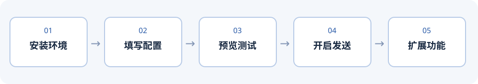

# 微信 AI 机器人：Windows 新手部署教程

这份教程从一台 Windows 电脑开始，先完成**文字回复预览**，再开启发送。图片、语音、视频和唱歌放在后面按需配置。



> 本项目仍是开源草稿：下面的教程根据现有代码和项目原有电脑的环境整理，**尚未在全新电脑上完整实测**。微信客户端、模型接口或依赖更新后，步骤可能需要调整。

## 1. 准备清单

| 项目 | 需要准备什么 |
| --- | --- |
| 电脑 | Windows 10/11、网络，以及可以保持登录和正常显示的桌面微信。上游依赖面向微信 Windows 4.x；具体兼容版本见[上游说明](https://github.com/fanyuantaier/wechatauto-replica)。 |
| Python | Python 3.12。上游依赖提供的验证环境也是 3.12。 |
| API | [DeepSeek 开放平台](https://platform.deepseek.com/)的 API 密钥，以及可用的服务余额或额度；使用时按服务商规则计费。 |
| 测试对象 | 一个愿意协助测试的微信好友和一个测试群。建议先从测试群开始，不要把真实密钥和聊天记录公开。 |
| 项目文件 | 解压项目压缩包，或以后从 GitHub 下载项目。解压后找到含 `bot.py`、`requirements.txt`、`.env.example` 的那一层目录。 |

预览模式也会调用模型，可能产生费用；程序读取微信聊天内容并将用于生成回复的内容发送给模型服务商。功能行为受到微信、Windows 和接口版本影响。

## 2. 安装 Python 3.12

1. 打开 [Python 3.12.10 官方下载页](https://www.python.org/downloads/release/python-31210/)，选择适合电脑的 Windows 安装方式。若官方页面推荐 Python 安装管理器，按其提示安装 Python 3.12。
2. 重新打开 PowerShell，输入：

   ```powershell
   py -3.12 --version
   ```

   出现 `Python 3.12.x` 表示这一步通过。如果提示找不到 `py`，检查是否安装了 Python Launcher 或 Python 安装管理器；安装后重新打开 PowerShell。Python 官网可能更新下载入口，请以官方页面为准。

## 3. 打开项目目录并安装依赖

1. 在文件资源管理器打开含 `bot.py` 的目录。
2. 单击窗口顶部地址栏，输入 `powershell` 后按 Enter。这样打开的 PowerShell 通常已位于该目录。
3. 先确认文件是否在当前目录：

   ```powershell
   Get-ChildItem bot.py, requirements.txt, .env.example
   ```

4. 依次执行：

   ```powershell
   py -3.12 -m venv .venv
   .\.venv\Scripts\python.exe -m pip install -r requirements.txt
   ```

   安装需要联网，第一次可能需要几分钟。看到成功安装提示后继续；如有红色错误信息，先不要继续启动。

5. 创建配置文件：

   ```powershell
   if (Test-Path .env) { Write-Host '配置已存在，请先检查，不会覆盖。' } else { Copy-Item .env.example .env }
   notepad .env
   ```

   如果 `.env` 已存在，先备份或检查原有内容，避免覆盖已有密钥。

## 4. 填写配置

在记事本中填写以下字段，等号后写自己的内容，保存并关闭。下面只是格式示例，不是真实密钥或联系人：

```dotenv
DEEPSEEK_API_KEY=在这里填写你自己的API密钥
AI_MODEL=deepseek-flash
ENABLE_SEND=0
ENABLE_VISION_UPLOAD=0
ENABLE_NATIVE_VOICE=0
ENABLE_PROACTIVE_PAT=0
PRIVATE_MODE=test
WECHAT_TEST_CONTACT=测试好友备注名
GROUP_NAMES=测试群名称
GROUP_TRIGGER=/ai
VOICE_GENDER=male
```

| 字段 | 作用 |
| --- | --- |
| `DEEPSEEK_API_KEY` | DeepSeek API 密钥；不要把密钥发进群聊、截图或提交 GitHub。 |
| `AI_MODEL` | 当前示例使用 `deepseek-flash`。模型可用性以 [DeepSeek 官方文档](https://api-docs.deepseek.com/)为准。 |
| `ENABLE_SEND` | `0` 为预览；`1` 才启用实际发送。 |
| `PRIVATE_MODE` | `test` 限制私聊只处理指定测试好友；`all` 会处理所有符合条件的私聊。 |
| `WECHAT_TEST_CONTACT` | `test` 模式必填，应与程序识别的好友聊天名称一致。 |
| `GROUP_NAMES` | 允许处理的群名，多个群用英文逗号分隔。**留空表示允许所有群，不表示关闭群聊。** |
| `ENABLE_VISION_UPLOAD` | `1` 允许将图片画面交给模型服务处理；默认 `0`。启用前确认当前模型支持图片及相关隐私设置。 |
| `ENABLE_NATIVE_VOICE` | `1` 启用原生语音相关功能；先按第 7 节准备环境。 |
| `ENABLE_PROACTIVE_PAT` | `1` 允许结合上下文主动拍一拍；首次部署建议保持 `0`。 |

群聊触发还会综合 @、微信昵称和上下文；`GROUP_TRIGGER` 是额外的触发设置。不要依赖 `PRIVATE_MODE=test` 限制群聊，群范围由 `GROUP_NAMES` 单独控制。

## 5. 首次运行：先预览

1. 登录电脑微信，确认选对了账号，保持微信进程运行。
2. 在项目目录的 PowerShell 中启动：

   ```powershell
   .\.venv\Scripts\python.exe bot.py
   ```

3. 等待出现类似 `微信 AI 智能助手已启动`、`自动发送：关闭` 的文字。
4. 请测试好友向当前账号发消息，或在已配置的测试群里 @ 当前账号。观察窗口是否显示收到消息、生成回复以及 `预览模式：未发送`。生成可能需要等待模型接口返回。
5. 如果窗口报错，先查看第 9 节；不要因为没有回复反复启动多个机器人进程。

预览模式关闭的是消息发送：模型调用仍会发生，部分媒体处理可能读取本地文件或操作微信界面。测试时请使用不敏感的内容。

## 6. 开启自动回复与停止

1. 在运行窗口按 `Ctrl+C` 停止机器人。
2. 重新打开 `.env`，将 `ENABLE_SEND=0` 改为 `ENABLE_SEND=1`，保存。
3. 再次运行 ` .\.venv\Scripts\python.exe bot.py `。从测试好友和测试群开始，确认微信里实际收到了回复，再决定是否扩大使用范围。

以后要停止，回到运行机器人的 PowerShell 窗口按 `Ctrl+C`。要恢复预览，停止后把 `ENABLE_SEND` 改回 `0` 并重新运行。

## 7. 可选功能

### 图片、表情和引用

先完成文字测试。确认模型支持视觉输入，并同意把收到的图片画面交给服务商处理后，将 `.env` 的 `ENABLE_VISION_UPLOAD` 改为 `1`，重启机器人。可在测试群发图片并明确询问内容。微信版本、媒体是否已缓存和模型支持情况都会影响结果；不要以文字测试通过推断图片功能也一定可用。

### 原生微信语音条

1. 在项目目录安装依赖：

   ```powershell
   .\.venv\Scripts\python.exe -m pip install -r requirements-voice.txt
   ```

2. 本功能使用 [VB-CABLE](https://vb-audio.com/Cable/) 虚拟音频设备，并需要 Windows 麦克风权限；按驱动官方说明完成安装与必要的重启。在 Windows 设置中确认允许桌面应用访问麦克风。
3. 将 `.env` 中 `ENABLE_NATIVE_VOICE=1`，重启机器人。使用受控测试聊天请求语音，并确认微信显示的是原生语音条。

音频设备名称、微信输入界面或系统权限不同都可能影响发送。驱动会修改系统音频设备；本教程没有在新电脑验证每个驱动安装步骤。

### 唱歌

唱歌需要语音相关环境，以及单独开通支持本项目接口的火山引擎实时语音服务，可能另行收费。安装：

```powershell
.\.venv\Scripts\python.exe -m pip install -r requirements-voice.txt -r requirements-singing.txt
```

在项目目录新建 `唱歌配置.env`，按服务商提供的凭据填写。程序支持以下两种认证格式中的一种：

```dotenv
SINGING_ENABLED=1
VOLC_SING_API_KEY=填写自己的API密钥
SINGING_MAX_SECONDS=35
```

或者保留 `SINGING_ENABLED` 和时长，将密钥行换成 `VOLC_SING_APP_ID=...` 和 `VOLC_SING_ACCESS_KEY=...`。配置文件不得上传 GitHub。确认服务已开通且密钥对应权限后重启；生成结果和原曲旋律是否一致取决于服务，不能保证。

### 视频

安装 `requirements-video.txt`，自行安装 FFmpeg，并确保 `ffmpeg.exe` 和 `ffprobe.exe` 位于同一目录，且能通过 PATH 找到。视频声音转写还需要兼容的 faster-whisper base 本地模型，放在项目的 `.models/faster-whisper-base/`。程序会检查 `model.bin`、`config.json`、`tokenizer.json`，且运行时不会自动下载模型。

目前仓库不包含模型或经完整验证的自动安装流程。画面分析还需要支持视觉的模型并启用图片上传；视频能否自动打开、下载和读取取决于微信界面及媒体状态。

### 联网搜索、群聊 @ 和拍一拍

联网搜索由程序按对话需要触发，依赖网络和外部服务。真实 @ 和拍一拍依赖微信群界面，先用测试群验证。只有将 `ENABLE_PROACTIVE_PAT=1` 才启用主动拍一拍；实际发送仍受 `ENABLE_SEND` 控制。

## 8. 多账号与隐私

没有 `称呼配置.json` 时，程序使用微信自动检测结果；多账号环境下应先确认选中的是预期账号，再开始测试。本地绑定文件可能包含账号和联系人标识，不随开源草稿提供。不要把配置、微信数据库、聊天记录、日志、缓存、生成图片、音频或模型文件提交到公开仓库。

项目会调用云端模型。请在涉及其他人的群聊中事先说明自动化和相关数据处理方式，并遵守所使用服务的规定。

## 9. 常见问题

| 现象 | 先检查什么 |
| --- | --- |
| `py` 找不到或没有 Python 3.12 | 完成第 2 节安装后重新打开 PowerShell，再运行 `py -3.12 --version`。 |
| 找不到 `bot.py` 或 `requirements.txt` | 你可能打开了外层目录；找到包含这些文件的项目目录，再从那里打开 PowerShell。 |
| 提示填写 DeepSeek API Key | 检查项目目录下 `.env` 是否存在、字段拼写是否为 `DEEPSEEK_API_KEY`，以及内容是否保存。 |
| 提示填写测试好友备注名 | `PRIVATE_MODE=test` 时必须填写 `WECHAT_TEST_CONTACT`。 |
| 模型请求失败 | 检查网络、密钥、账户余额、模型名称及服务状态；不要把完整密钥贴给别人。 |
| 机器人已启动但没有收到消息 | 检查微信登录账号、好友名或群名、群范围，以及窗口是否提示数据库或监听错误；可参考[上游使用指南](https://github.com/fanyuantaier/wechatauto-replica/blob/main/GUIDE.md)。 |
| 显示“预览模式：未发送” | `ENABLE_SEND=0` 是预期行为。确认预览正确后按第 6 节启用。 |
| 有回复但微信没有发出去 | 查看窗口里的发送结果；检查目标聊天和微信窗口是否可用。微信版本或界面差异可能导致自动化失败，不要盲目连续重试。 |
| 看不到图片或听不到视频 | 检查媒体是否已成功下载、视觉上传是否允许、模型是否支持图片，以及视频工具和本地模型是否就绪。 |
| 语音条不可用 | 确认可选依赖、VB-CABLE 设备、麦克风权限以及微信输入界面；使用测试聊天检查。 |

遇到问题时，整理**去掉密钥、账号和聊天内容后的**错误信息及系统、Python、微信版本，便于排查。
